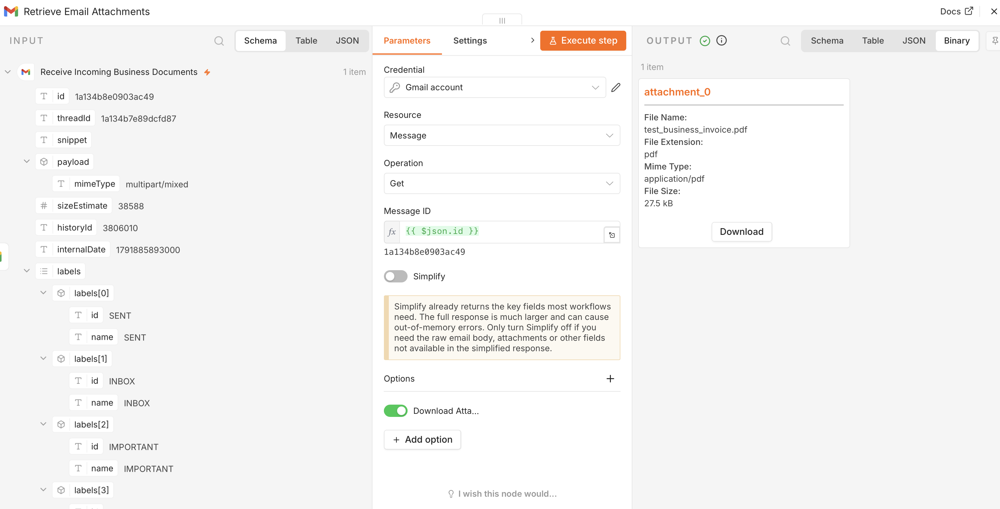
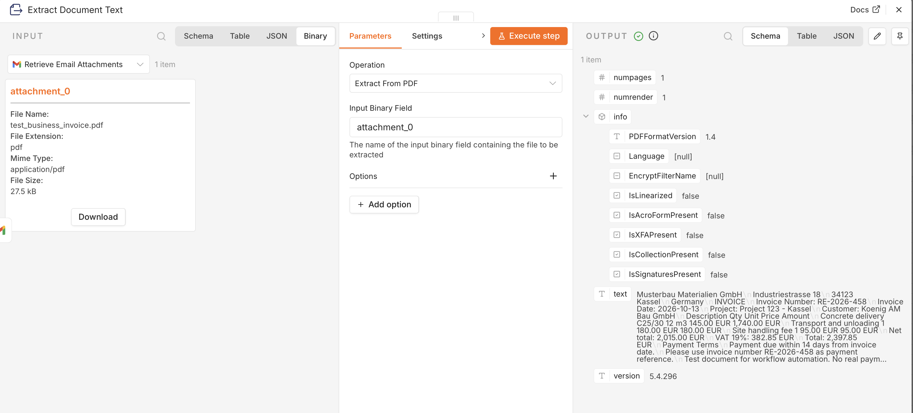
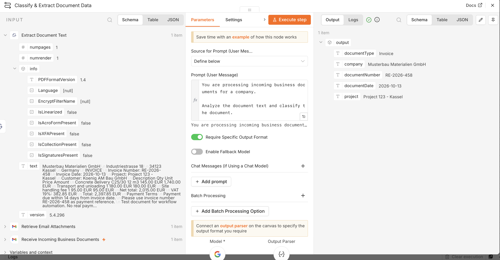
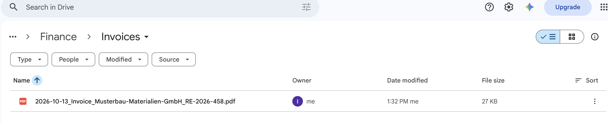
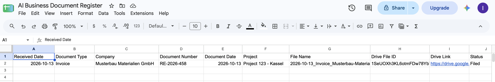
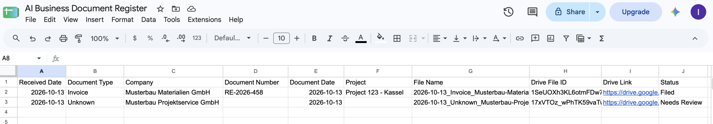
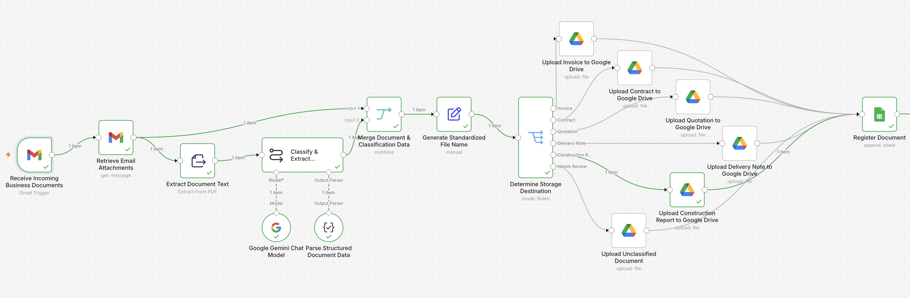
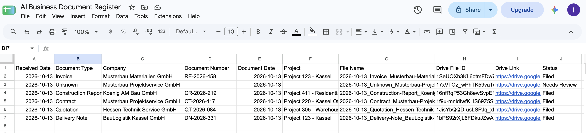

# AI Business Document Management

Automated business document processing workflow built with **n8n**, **Gmail**, **Google Gemini**, **Google Drive**, and **Google Sheets**.

The workflow receives business documents by email, extracts PDF text, classifies the document with AI, generates a standardized file name, routes the file to the correct Google Drive folder, and registers the result in a central document log.

## Workflow

**Gmail → PDF Extraction → AI Classification → File Naming → Document Routing → Google Drive → Google Sheets Register**

Supported document types:

- Invoice
- Contract
- Quotation
- Delivery Note
- Construction Report
- Unknown / Needs Review

## Key Features

- Automatic Gmail document intake
- PDF attachment retrieval
- Text extraction from PDF files
- AI-powered document classification and metadata extraction
- Structured output parsing
- Standardized file naming
- Rule-based routing to Google Drive folders
- Separate fallback routing for unclassified documents
- Automatic document registration in Google Sheets
- Status tracking with `Filed` and `Needs Review`

## Extracted Document Data

The AI classification step extracts:

- Document Type
- Company
- Document Number
- Document Date
- Project

Example standardized file name:

`2026-10-13_Invoice_Musterbau-Materialien-GmbH_RE-2026-458.pdf`

## Screenshots

### 1. Email Attachment Retrieved

### 2. Document Text Extracted

### 3. AI Document Classification

### 4. Invoice Routed to Google Drive

### 5. Document Register Updated

### 6. Document Register Status Results

### 7. Final Workflow Canvas

### 8. Final Document Register

## Test Results

The workflow was tested with six document scenarios:

| Document Type | Result |
|---|---|
| Invoice | Filed |
| Contract | Filed |
| Quotation | Filed |
| Delivery Note | Filed |
| Construction Report | Filed |
| Unknown | Needs Review |

Each recognized document was routed to the appropriate Google Drive folder and added to the document register. Unclassified documents were routed to the **Needs Review** folder for manual review.

## Technologies

- n8n
- Gmail
- Google Gemini
- Google Drive
- Google Sheets
- Structured Output Parser
- PDF text extraction

## Business Use Case

This workflow can be used by small and medium-sized businesses to reduce manual document handling, improve file organization, standardize naming conventions, and maintain a searchable document register across incoming business correspondence.
